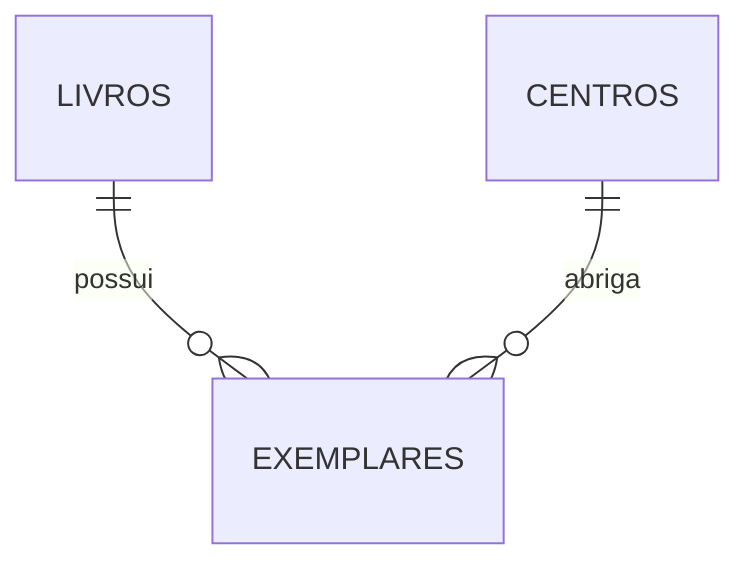

# Backend do Espaço de Leitura Digital

O acervo está integrado à API Express e ao PostgreSQL para consultar, cadastrar e editar obras e adicionar exemplares. Abra http://127.0.0.1:3001/acervo.html com o backend em execução. Não use arquivo local ou Live Server para essa página: as chamadas /api usam o mesmo endereço da página. Os antigos livros de demonstração não são importados automaticamente. A migração para Next.js será uma etapa posterior.

O dashboard (`/dashboard.html`) também vem da API: os totais de obras, exemplares disponíveis, empréstimos em curso e atrasados, além da lista de empréstimos recentes, são calculados a partir de `/api/livros` e `/api/emprestimos` por `js/dashboard.js`. As páginas usam Bootstrap e Bootstrap Icons copiados para `assets/vendor/`, sem depender de CDN.

As telas de leitores, empréstimos e devoluções têm guias próprios em `docs/`.

## Modelo do acervo



| Tabela | O que representa | Campos principais |
| --- | --- | --- |
| `livros` | Uma obra/edição cadastrada | título, autor, ISBN, editora, ano, categoria, faixa etária, capa e sinopse |
| `centros` | Um Centro de Educação | identificador e nome único |
| `exemplares` | Uma cópia física | livro, Centro, código único, localização e status |

Um livro pode possuir cópias em vários Centros. Por isso, `centro_id` pertence ao exemplar. Quantidade, disponibilidade e status geral da obra são calculados, em vez de armazenados em campos que poderiam ficar desatualizados.

O banco gera os identificadores e códigos `EX-0001`, `EX-0002` etc. Não usamos um contador do navegador, que poderia gerar códigos repetidos com várias pessoas cadastrando ao mesmo tempo. Códigos podem ter intervalos após uma transação cancelada; isso é normal. A expressão também preserva códigos com mais de quatro dígitos.

Os status físicos previstos são Disponível, Emprestado, Reservado, Danificado, Perdido e Baixado. Indisponível é uma classificação geral calculada da obra. A presença de Reservado no modelo não implementa o fluxo de reservas.

ISBN é opcional e não tem restrição de unicidade nesta etapa. Categorias e faixas etárias permanecem textuais por enquanto. Leitores e empréstimos já têm migrações próprias; usuários e permissões serão implementados depois. Empréstimos usam prazo de 15 dias corridos e limite de 5 exemplares simultâneos por leitor. Consulte `docs/EMPRESTIMOS.md` para entender as renovações e o fluxo do código.

## Organização e fluxo

```text
Requisição HTTP → rotas Express → validação (services) → consultas SQL (repositories) → PostgreSQL → resposta JSON
```

O código em `src/` fica separado em camadas:

- `src/server.js`: inicia o processo na porta 3001 e fecha as conexões ao encerrar.
- `src/app.js`: monta os middlewares, as camadas de rotas e os arquivos estáticos, e concentra o tratador de erros. É o único lugar que liga as camadas: `criarBanco()` → `criarApp(banco)` → `criarRepositorioX(banco)` → `criarRotasX(repositorio)`.
- `src/routes/`: define os endereços de cada domínio (`health.js`, `acervo.js`, `leitores.js`, `emprestimos.js`). Cada arquivo devolve um router criado por `criarRotas<Domínio>(repositorio)`, e as rotas com `:id` registram o middleware `validarId`.
- `src/middlewares/`: `validarId.js` valida o parâmetro `:id` e o entrega convertido em número; `api.js` aplica a política de `/api` (sem cache, gravação apenas da própria origem e corpo em JSON).
- `src/services/validation/`: valida e normaliza os dados recebidos antes de chegarem ao banco (`acervo.js`, `leitores.js`, `emprestimos.js` e os helpers de `comum.js`).
- `src/repositories/`: reúne as consultas SQL e as transações (`acervo.js`, `leitores.js`, `emprestimos.js`). Não depende de rotas nem de services.
- `src/settings/database.js`: mantém um conjunto reutilizável de conexões, chamado pool.
- `src/utils/datas.js`: datas civis usadas pelo servidor. O navegador mantém a cópia em `js/datas.mjs`, porque não é possível importar de uma pasta para a outra sem publicar o backend; `test/datas.test.js` compara as duas e falha se elas divergirem.
- `src/errors/`: erros de domínio que carregam o status HTTP (`erroHttp` mais os atalhos de validação, não encontrado e conflito), usados por services, repositories e pelo tratador de erros.
- `database/`: as migrações numeradas. `scripts/migrate.js` aplica todos os `.sql` da pasta em ordem de nome e registra cada um em `schema_migrations`, dentro de uma transação.
- `test/`: testes HTTP com um banco substituto (`api.test.js`) e testes que precisam de PostgreSQL (`*.test.js` com a variável de `test/integracao.env`).
- `docs/`: guias por etapa de implementação (leitores, empréstimos, devoluções e baixa de exemplares) e `ETAPAS.md` com o registro das verificações já feitas.

`PRIMARY KEY` identifica um registro. `REFERENCES` exige que o livro e o Centro de um exemplar existam. `CHECK` rejeita valores inválidos. `ON DELETE RESTRICT` impede apagar uma obra ou Centro enquanto houver exemplares vinculados.

Uma transação permite criar todas as tabelas juntas ou desfazer a tentativa se houver erro. Execute a migração em um banco novo e dedicado ao projeto. Ela não apaga tabelas existentes e, após aplicada, uma nova execução informa que o banco já está atualizado. Mudanças futuras devem usar novas migrações.

## Executar a API localmente

Use Node.js 22.9 ou superior e pnpm. Os comandos abaixo são executados dentro da pasta `backend`:

```powershell
pnpm install
pnpm db:migrate   # aplica as migrações numeradas (o banco precisa estar no ar)
pnpm test
pnpm dev
```

`pnpm test` roda a suíte que não precisa de banco. Para rodar também os testes de integração, que criam e removem um schema temporário no PostgreSQL, use `pnpm test:integracao` com o `.env` configurado.

Também é possível iniciar sem o atalho do gerenciador, depois da instalação das dependências:

```powershell
node --env-file-if-exists=.env src/server.js
```

Abra `http://127.0.0.1:3001/api/health`. A resposta `status: ok` confirma apenas que a API está rodando. A raiz (`/`) redireciona para `/acervo.html`; o `index.html` faz o mesmo. A API fica restrita ao próprio computador nesta etapa e ainda não tem autenticação.

## Configurar o banco de dados

O projeto não exige Docker nem serviço específico: precisa de um PostgreSQL no ar, local ou hospedado.

1. Crie um banco dedicado `espaco_leitura` e um usuário com permissão para criar tabelas nesse banco.
2. Copie `.env.example` para `.env` dentro de `backend` e preencha `PGHOST`, `PGPORT`, `PGDATABASE`, `PGUSER` e `PGPASSWORD`. Os campos separados permitem usar a senha sem codificação de URL. Mantenha a senha entre aspas para preservar caracteres como `#`; se ela contiver aspas duplas, use aspas simples externas (ou vice-versa). Não envie credenciais pelo chat.
3. Rode `pnpm db:migrate`.
4. Inicie ou reinicie a API e abra `/api/health/db`.

O banco precisa existir antes de `db:migrate`. Para bancos hospedados, use `DATABASE_URL` (tem prioridade sobre os campos separados) e os certificados indicados pelo provedor, sem desativar a verificação TLS.

O arquivo `.env` está ignorado no Git. A migração inicial insere apenas CE Maranhão, CE Piauí e CE Bahia; a consulta de livros retornará `[]` até haver obras no banco. Convém manter o fuso do banco em `America/Fortaleza`: as regras de data usam a data civil de Fortaleza e o banco também valida `data_nascimento <= CURRENT_DATE`.

## Endereços desta etapa

| Método e caminho | Resultado |
| --- | --- |
| `GET /api/health` | Confirma que o processo está respondendo |
| `GET /api/health/db` | Executa uma consulta real de conectividade |
| `GET /api/centros` | Lista Centros |
| `GET /api/livros` | Lista obras e seus exemplares |
| `GET /api/livros/1` | Consulta uma obra por ID |
| `POST /api/livros/1/exemplares` | Adiciona cópias a uma obra existente |
| `POST /api/exemplares/1/baixa` | Registra a baixa de uma cópia |
| `GET /api/leitores` · `GET /api/leitores/1` | Lista e consulta leitores |
| `POST /api/leitores` · `PUT /api/leitores/1` | Cadastra e edita leitor |
| `GET /api/emprestimos` · `GET /api/emprestimos/1` | Lista e consulta empréstimos com histórico |
| `GET /api/emprestimos/opcoes` | Leitores ativos e cópias disponíveis para a retirada |
| `POST /api/emprestimos` | Registra a retirada |
| `POST /api/emprestimos/1/renovacoes` | Renova o prazo |
| `POST /api/emprestimos/1/devolucao` | Registra a devolução |

ID inválido retorna 400; obra, leitor, empréstimo ou rota inexistente, 404; conflito de regra (limite de cinco, cópia já emprestada, registro já encerrado), 409; banco não configurado ou conexão recusada, 503; outros erros de consulta, 500. Banco sem configuração responde com a orientação de criar o `.env`, e não com a mensagem de serviço fora do ar. As respostas não incluem credenciais nem SQL interno.

### Gravações

- `POST /api/livros`: recebe os dados da obra, `quantidade`, `centroId` e `localizacao`; salva a obra e as cópias em uma transação e retorna 201 com o livro completo.
- `PUT /api/livros/:id`: atualiza os dados da obra e preserva os exemplares; retorna 200 com o livro completo.
- `POST /api/livros/:id/exemplares`: recebe `quantidade`, `centroId` e `localizacao`; retorna 201 com a obra atualizada.

As gravações aceitam JSON, validam os dados no servidor e usam parâmetros SQL. São permitidos lotes de 1 a 1000 cópias por envio; esse limite é operacional e não limita o total da obra. IDs e códigos vêm do banco. O estado na tela só é atualizado depois da confirmação da API. Não existe repetição automática de gravações quando a rede falha: confira o acervo antes de tentar novamente.

Express serve apenas as páginas públicas e as pastas css, js e assets. A raiz do projeto, o backend e o .env não são servidos. A interface usa a mesma origem da API; pedidos de gravação vindos de outra origem são rejeitados. Essa proteção não substitui login: a API permanece local e a autenticação ainda está pendente.

## Limites da verificação

Os testes HTTP usam respostas controladas no lugar do PostgreSQL. Eles verificam rotas, parâmetros, erros e formato da resposta; não validam a execução do SQL. A suíte automatizada não substitui testes de integração com PostgreSQL real.

Os testes de integração criam e removem somente um schema aleatório com prefixo `teste_acervo_`; o usuário do banco precisa ter permissão para criar e apagar schema. Eles ficam desligados em `pnpm test` e ligados em `pnpm test:integracao`, rodando contra o PostgreSQL indicado no `.env`. `test/datas.test.js` não precisa de banco: compara o módulo de datas do servidor com o do navegador. O registro do que já foi verificado em cada etapa está em `docs/ETAPAS.md`.

## Referências

- [Rotas no Express](https://expressjs.com/en/guide/routing/)
- [Pool de conexões do node-postgres](https://node-postgres.com/features/pooling)
- [Consultas parametrizadas](https://node-postgres.com/features/queries)
- [Definição de dados no PostgreSQL](https://www.postgresql.org/docs/current/ddl.html)
